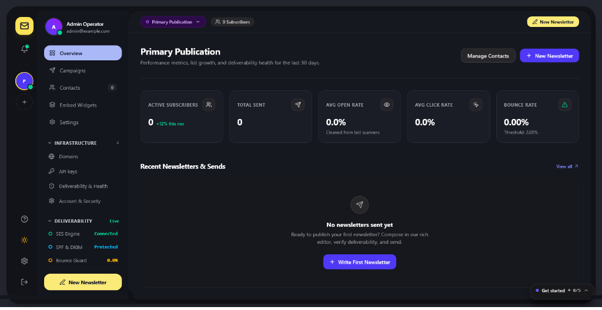
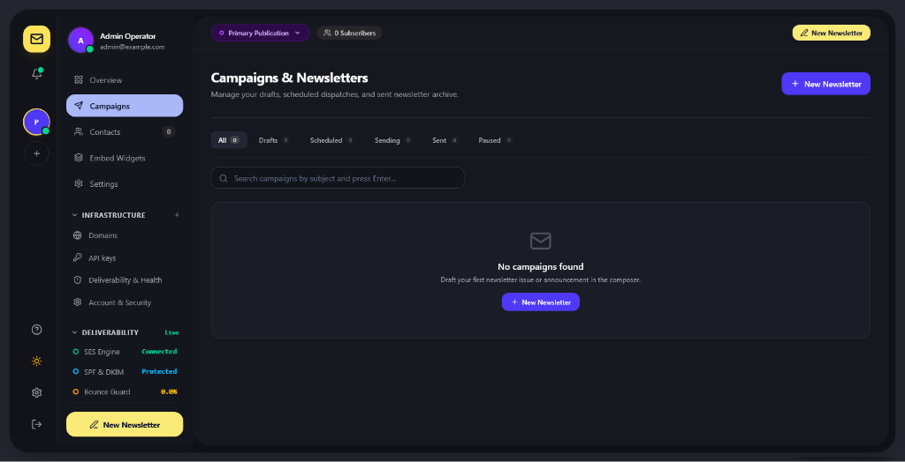
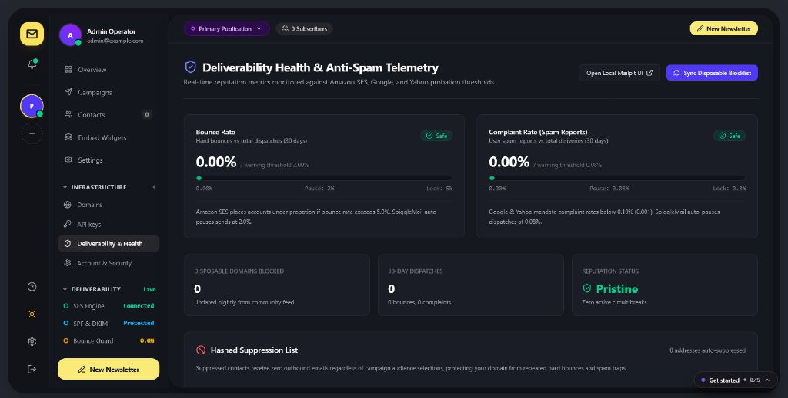
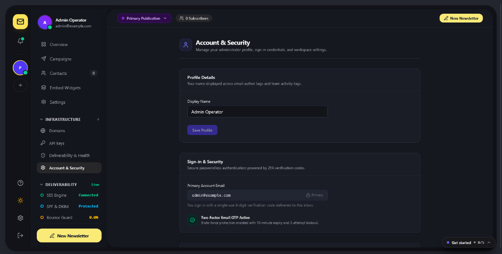
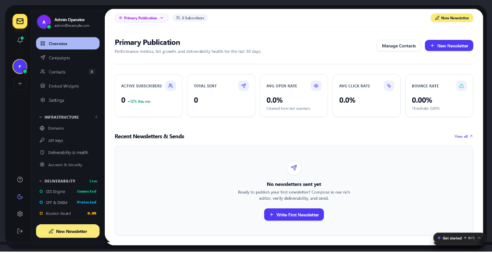

# SpiggleMail Core

<p align="left">
  <a href="https://github.com/skillbobby/Spiggle-Mail-Core/releases"></a>
  <a href="https://opensource.org/licenses/MIT"></a>
  <a href="https://laravel.com"></a>
  <a href="https://www.php.net"></a>
  <a href="https://react.dev"></a>
  <a href="https://www.typescriptlang.org"></a>
  <a href="https://inertiajs.com"></a>
  <a href="https://tailwindcss.com"></a>
  <a href="https://vitejs.dev"></a>
  <a href="https://aws.amazon.com/ses/"></a>
  <a href="https://tiptap.dev"></a>
  <a href="https://phpunit.de"></a>
  <a href="https://laravel.com/docs/pint"></a>
</p>

**Self-hosted, single-operator newsletter & AWS SES broadcast platform (Community Edition — MIT License).**

SpiggleMail Core gives independent creators, developers, and companies complete ownership over their email subscriber list, web archive, and Amazon SES sender reputation—without per-subscriber SaaS markups or public multi-tenant attack surface.

> **Looking for zero-ops managed hosting & multi-tenant workspaces?** Check out **SpiggleMail Cloud**, our managed SaaS edition with turnkey AWS SES infrastructure, multi-workspace management, and managed deliverability.

---

## Screenshots

| **Command Center & Overview** | **Campaigns & Newsletters** |
|:---:|:---:|
|  |  |
| **Deliverability & Reputation Guard** | **Account & Operator Security** |
|  |  |

<details>
<summary>☀️ <b>View Light Theme Screenshot</b></summary>
<br />

| **Command Center (Light Mode)** |
|:---:|
|  |

</details>

---

## Key Features

- **Modern 3-Column Content Studio & Real-Time Composer**
  - **Distraction-Free Newsletters**: Interactive high-contrast personalization pills (`{{ contact.name }}`, `{{ unsubscribe_url }}`), unified Content Studio toolbar, embedded drag-and-drop image uploader, and instant Gmail 102KB clip-size alerts.
- **Locked-Down Single-Operator Mode (`SPIGGLE_EDITION=core`)**
  - **Zero Public Signups**: Passwordless 6-digit OTP sign-in is strictly restricted to `OWNER_EMAIL` (or the initial operator who claims a fresh database). Unrecognized emails cannot create accounts or request OTPs.
- **First-Class AWS SES Reputation Protection**
  - **Real Easy DKIM + Custom `MAIL FROM`**: Registers sending domains directly via AWS SES v2 API (`createEmailIdentity` + `putEmailIdentityMailFromAttributes`), displaying all 3 `.dkim.amazonses.com` CNAME records, SPF, DMARC, and regional `feedback-smtp.{region}.amazonses.com` MX records.
  - **Cryptographic AWS SNS Webhook (`POST /api/webhooks/ses`)**: Verifies AWS X.509 SNS signatures, auto-confirms `SubscribeURL` safely, deduplicates retries, distinguishes **Transient** (3-strike soft bounce) vs **Permanent** (immediate hard bounce), and suppresses spam complaints immediately.
  - **Automated Circuit Breakers**: Pauses campaigns automatically at **2.0% bounce** or **0.08% complaint** rates and halts sending at **5.0% bounce** / **0.3% complaint** thresholds—well inside AWS SES enforcement limits.
  - **RFC 8058 One-Click Unsubscribe & Multipart MIME**: Every broadcast includes signed `List-Unsubscribe` + `List-Unsubscribe-Post: List-Unsubscribe=One-Click` headers, automatic `text/plain` MIME generation, and CAN-SPAM physical address footers.
- **Subscriber Hygiene & Lifecycle**
  - Syntax, typo suggestion, disposable-domain blocklist, MX DNS verification, CSV formula-injection sanitization, double opt-in confirmation, welcome emails, and automated inactive-subscriber sunsetting (`/keep` re-engagement).
- **Campaign Composer, Public Archive & Feeds**
  - Rich HTML/Markdown composer, A/B subject-line split testing, 5% warm-up pilot slices, open & per-URL click analytics (with corporate link-scanner filtering), sanitized public web archive (`/archive/{slug}`), RSS 2.0 feed, and XML sitemap.
- **Developer REST API v1 & Model Context Protocol (MCP) Server**
  - Role-scoped Bearer API keys (`full_access`, `send_only`, `read_only`), OpenAPI 3.0 spec (`/api/v1/openapi.json`), `llms.txt`, and built-in JSON-RPC 2.0 MCP server (`/api/mcp`) for Claude, Cursor, and autonomous agents.

---

## 🛠️ Technologies & Stack Versions

| Layer | Technology | Version | Purpose |
|:---|:---|:---:|:---|
| **Backend Framework** | [Laravel](https://laravel.com) | `13.x` (`13.40.0`) | Application core, queue workers, job dispatchers, and security middleware |
| **Backend Language** | [PHP](https://www.php.net) | `^8.3` (tested on `8.5`) | Strict typed engine, OpenSSL cryptography, and native Ulid generation |
| **Frontend UI** | [React](https://react.dev) | `19.x` (`19.3.1`) | High-performance interactive dashboard, wizards, and content studio |
| **Type System** | [TypeScript](https://www.typescriptlang.org) | `7.x` (`7.0.2`) | Strict type checking with comprehensive data contracts across all views |
| **SPA Bridge** | [Inertia.js](https://inertiajs.com) | `3.x` | Monolith modern routing with zero client-side state boilerplate |
| **Design System** | [Tailwind CSS](https://tailwindcss.com) | `v4.x` (`4.3.4`) | High-contrast design system with `@custom-variant dark` theme support |
| **Bundler & HMR** | [Vite](https://vitejs.dev) | `8.x` (`8.0.0`) | Sub-second frontend HMR and optimized production asset minification |
| **SES Dispatch SDK** | [Amazon SES PHP SDK](https://aws.amazon.com/ses/) | `v3.x` (`^3.402`) | Official AWS SDK for Easy DKIM, custom MAIL FROM, and batch sending |
| **Content Studio** | [TipTap](https://tiptap.dev) | `3.x` (`3.32.2`) | Headless rich-text editor for markdown/HTML with dynamic shortcodes |
| **Iconography** | [Lucide React](https://lucide.dev) | `1.x` (`1.68.0`) | Semantic, accessible SVG icon library |
| **Data Importer** | [PapaParse](https://www.papaparse.com/) | `5.x` (`5.7.0`) | High-speed client-side chunked CSV streaming & header mapping |
| **Code Style** | [Laravel Pint](https://laravel.com/docs/pint) | `1.x` (`1.27.0`) | Automated PSR-12 code style enforcer |
| **Testing** | [PHPUnit](https://phpunit.de) | `12.x` (`12.5.12`) | 94 automated feature tests covering deliverability, auth, and SES APIs |
| **Database** | SQLite / MySQL / PostgreSQL / MariaDB | Any | Zero-config SQLite default with seamless enterprise database switching |
| **Cache & Queue** | Database / Redis ([Predis](https://github.com/predis/predis)) | `3.x` (`3.7.0`) | High-throughput asynchronous batch workers and rate limiting |

---

## Requirements

- **PHP 8.3+** (`openssl`, `pdo_sqlite` or `pdo_mysql`, `mbstring`, `fileinfo`, `xml`, `curl`)
- **Composer 2.x**
- **Node.js 20+** & **npm**
- **Database**: SQLite (zero-config default) or MySQL / MariaDB / PostgreSQL
- **Amazon SES Account** (or local Mailpit `:1025` for zero-cost local development)

---

## Quickstart Installation

```bash
# 1. Clone the repository
git clone https://github.com/skillbobby/Spiggle-Mail-Core.git
cd Spiggle-Mail-Core

# 2. Install PHP & frontend dependencies
composer install
npm install

# 3. Configure environment & lock to your operator email
cp .env.example .env
php artisan key:generate
```

Edit `.env` and set your operator email and public URL:

```dotenv
APP_NAME="SpiggleMail Core"
APP_ENV=production
APP_DEBUG=false
APP_URL=https://mail.yourdomain.com

SPIGGLE_EDITION=core
OWNER_EMAIL=you@yourdomain.com
```

Initialize the database, storage symlink, and production frontend bundle:

```bash
touch database/database.sqlite
php artisan migrate --seed --force
php artisan storage:link
npm run build
```

---

## Connecting Amazon SES Safely (Reputation Checklist)

1. **Request AWS SES Production Access** in your chosen AWS region (Sandbox accounts are capped at 200 emails/24h and verified recipients only).
2. **Create an SES Configuration Set** (e.g. `spiggle-reputation-events`) in the AWS SES Console:
   - Add an **SNS Event Destination** for **Bounces**, **Complaints**, and **Deliveries**.
   - Subscribe your SNS Topic (HTTPS protocol) to:
     ```text
     https://mail.yourdomain.com/api/webhooks/ses
     ```
     SpiggleMail automatically verifies the AWS X.509 signature and confirms the `SubscribeURL`.
3. **Configure Credentials**:
   - Either set `SES_DRIVER=live`, `AWS_ACCESS_KEY_ID`, `AWS_SECRET_ACCESS_KEY`, `AWS_DEFAULT_REGION`, and `AWS_SES_CONFIGURATION_SET` in `.env`, **or** enter them in **Settings -> Mail Dispatch Engine** (encrypted at rest with `AES-256-CBC`).
   - Click **Verify SES Account & Quotas** in `/settings` to confirm Production Access and inspect your `MaxSendRate`.
4. **Verify Your Sending Domain (`/domains`)**:
   - Add your domain in `/domains`, publish all **3 Easy DKIM CNAMEs**, **SPF**, **DMARC**, and **Custom MAIL FROM** (`MX` + `TXT` on `mail.yourdomain.com`), and click **Recheck DNS Records**.
   - Live SES campaign dispatches are blocked until your sender domain is verified.

---

## Running Queue Workers & Scheduler in Production

Run a queue worker (via Supervisor or `systemd`) and the Laravel scheduler cron:

```bash
# Queue worker for rate-paced campaign batches & transactional emails
php artisan queue:work --tries=3 --timeout=120

# Crontab entry (every minute) for scheduled campaigns, warm-up slices & list cleanup
* * * * * cd /path/to/Spiggle-Mail-Core && php artisan schedule:run >> /dev/null 2>&1
```

---

## Running Tests

```bash
php artisan test
```

---

## Security & License

- Credentials stored via the UI are encrypted at rest using Laravel `APP_KEY` (`AES-256-CBC`) and masked in responses.
- Licensed under the [MIT License](LICENSE).
