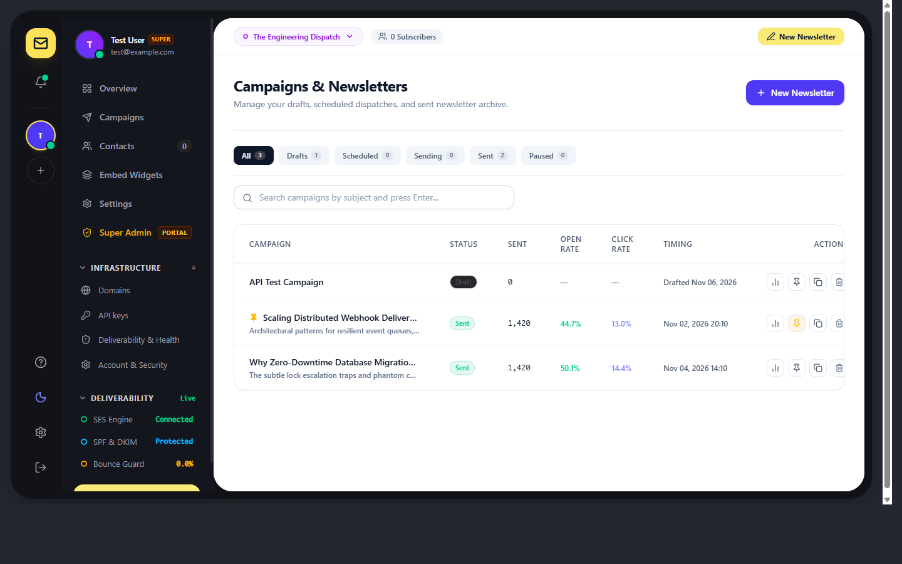
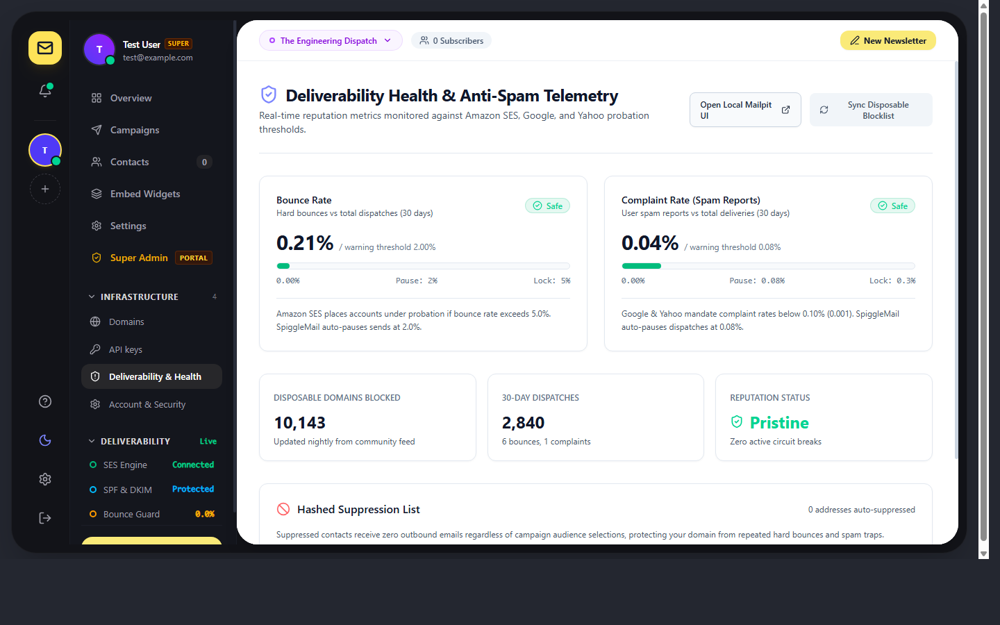
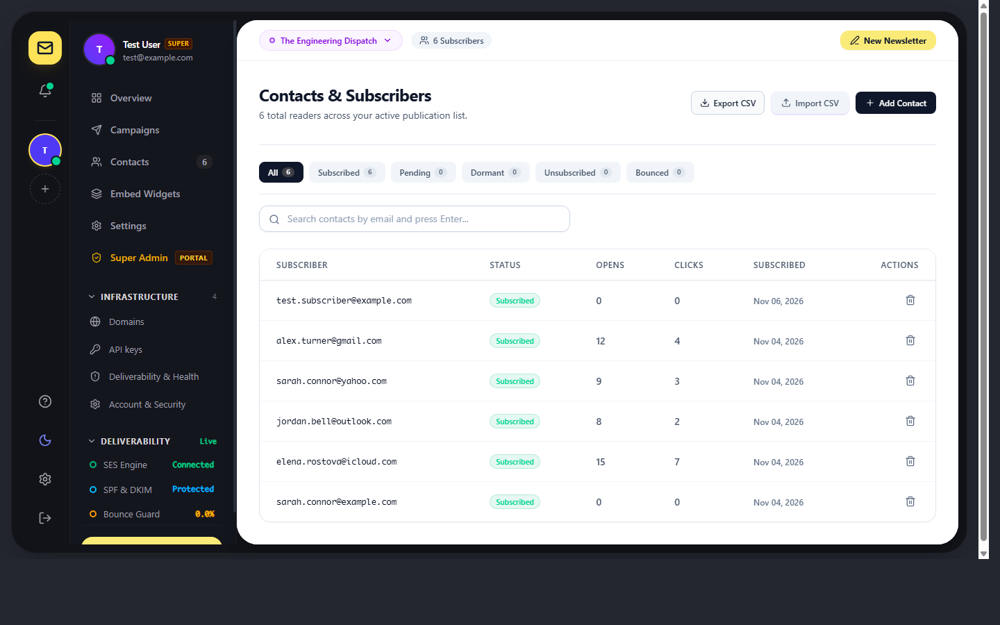

# MailJinny

<p align="left">
  <a href="https://github.com/skillbobby/Spiggle-Mail-Core/releases"></a>
  <a href="LICENSE"></a>
  <a href="https://mailjinny.com"></a>
  <a href="https://laravel.com"></a>
  <a href="https://www.php.net"></a>
  <a href="https://react.dev"></a>
  <a href="https://www.typescriptlang.org"></a>
  <a href="https://inertiajs.com"></a>
  <a href="https://tailwindcss.com"></a>
  <a href="https://aws.amazon.com/ses/"></a>
  <a href="https://phpunit.de"></a>
</p>

**MailJinny** is the free, self-hosted, source-available edition (managed hosting is available as **MailJinny Cloud**) under the [Elastic License 2.0](LICENSE) — free to use, modify, and self-host, not for resale or commercial SaaS redistribution. Built with **Laravel 13**, **Inertia.js (React 19 + TypeScript)**, **MariaDB**, **Redis**, and **Amazon SES**.

It gives independent creators, developers, and businesses complete ownership over their email subscriber list, publication archive, and sender reputation—without per-subscriber SaaS markups or vendor lock-in.

> 🌐 **Official Website & Docs:** [mailjinny.com](https://mailjinny.com)  
> 📺 **Video Walkthrough:** [Watch the Product Demo on YouTube](https://youtu.be/hnmezxkxtVE?si=23Iw-48VrmT7soaO)

<p align="left">
  <a href="https://github.com/sponsors/skillbobby">
    
  </a>
</p>

---

## Interactive Product Tour

*(Click any screenshot to inspect full high-resolution detail)*

| [**Command Center & Send Queue**](docs/images/overview-light.png) | [**Campaign Studio**](docs/images/campaigns-light.png) |
|:---:|:---:|
| <a href="docs/images/overview-light.png"></a> | <a href="docs/images/campaigns-light.png"></a> |
| [**Deliverability & Reputation Guard**](docs/images/deliverability-light.png) | [**Audience & Contact Hub**](docs/images/contacts-light.png) |
| <a href="docs/images/deliverability-light.png"></a> | <a href="docs/images/contacts-light.png"></a> |

<details>
<summary>🌙 <b>Looking for Dark Mode? Click to preview dark theme screenshots</b></summary>
<br />

| [**Overview (Dark)**](docs/images/overview-dark.png) | [**Campaigns (Dark)**](docs/images/campaigns-dark.png) |
|:---:|:---:|
| <a href="docs/images/overview-dark.png"></a> | <a href="docs/images/campaigns-dark.png"></a> |
| [**Deliverability (Dark)**](docs/images/deliverability-dark.jpg) | [**Security Center (Dark)**](docs/images/account-security-dark.png) |
| <a href="docs/images/deliverability-dark.jpg"></a> | <a href="docs/images/account-security-dark.png"></a> |

</details>

---

## Built-in Features

1. **Campaign Studio**
   - Clean, distraction-free markdown and rich visual composer.
   - Live split preview, dynamic personalization tokens (`{{ contact.name }}`), and real-time Gmail 102KB clip alerts.
2. **Scheduling & Smart Queues**
   - Schedule dispatches to the exact minute.
   - Redis-backed high-throughput queue with rate limiting and automated recovery.
3. **Publication Website & RSS 2.0**
   - Every newsletter issue publishes automatically to your clean public website (`/archive`).
   - Automatically generates an RSS 2.0 syndication feed and XML sitemap for SEO discovery.
4. **Custom Domain & Reputation Guard**
   - Send from your own domain (`hello@yourbrand.com`).
   - Automated SPF, DKIM 2048-bit, and DMARC verification checklist.
   - Strict adherence to the 2024 Google & Yahoo bulk sender mandates.
5. **RFC 8058 One-Click Unsubscribe**
   - Generates cryptographically signed `List-Unsubscribe` and `List-Unsubscribe-Post: List-Unsubscribe=One-Click` headers.
   - Prevents recipients from clicking the spam button when they simply want to unsubscribe.
6. **Embeddable Signup Forms & Automations**
   - Minimalist copy-paste HTML/JS forms for any landing page or CMS.
   - Automated double opt-in confirmations and instant welcome drip messages.
7. **1-Click Subscriber Imports**
   - High-speed streaming CSV import via PapaParse.
   - Direct migration presets for Substack, Mailchimp, and Beehiiv.
8. **Honest Human Analytics**
   - Transparent opens and click heatmaps.
   - Anti-bot link scanner filtering so security crawlers don't artificially inflate your metrics.
9. **Model Context Protocol (MCP) Agent Hub**
   - Native `/api/mcp` JSON-RPC 2.0 endpoint for Claude Code, Cursor, Codex, and AI autonomous agents.
   - Manage subscriber queries, campaign drafts, and delivery health programmatically.

---

## Technical Architecture

| Layer | Technology | Purpose |
|:---|:---|:---|
| **Backend Framework** | [Laravel 13](https://laravel.com) | Multi-tenant SaaS foundation, queue pipelines & scheduling |
| **Backend Runtime** | [PHP ^8.3 \| 8.5](https://www.php.net) | Strict typing, OpenSSL cryptography, native ULID generation |
| **Frontend UI** | [React 19](https://react.dev) | Interactive dashboard, campaign composers, and deliverability dials |
| **Type System** | [TypeScript 7.x](https://www.typescriptlang.org) | Strict typed contracts across frontend components |
| **Fullstack Bridge** | [Inertia.js 3.x](https://inertiajs.com) | Monolithic ergonomics with modern client-side routing |
| **Styling** | [Tailwind CSS v4](https://tailwindcss.com) | High-contrast design tokens with seamless dark mode support |
| **SES Dispatch SDK** | [AWS SES SDK v3](https://aws.amazon.com/ses/) | Easy DKIM, custom MAIL FROM, batch sending & webhook telemetry |
| **Data Persistence** | MariaDB 10.x+ / MySQL / PostgreSQL | Relational ACID storage with single-operator or tenant isolation |
| **Cache & Queue** | Redis ([Predis](https://github.com/predis/predis)) | High-throughput async batch workers and rate limiting |
| **Testing Suite** | [PHPUnit 12](https://phpunit.de) | 94 passing tests covering deliverability, queues, and security |

---

## Quickstart (Self-Hosted)

### Prerequisites
- PHP 8.2+
- Composer
- Node.js 20+ & npm
- MariaDB or MySQL
- Redis

### Installation Steps

```bash
# 1. Clone the repository
git clone https://github.com/skillbobby/Spiggle-Mail-Core.git
cd Spiggle-Mail-Core

# 2. Install PHP and Node dependencies
composer install
npm install

# 3. Configure environment
cp .env.example .env
php artisan key:generate

# 4. Run database migrations & seeders
php artisan migrate --seed

# 5. Sync disposable email domain blocklist (10,143+ domains)
php artisan deliverability:sync-disposable-domains

# 6. Build production frontend assets
npm run build

# 7. Start the local development server
php artisan serve
```

### Docker Quickstart (Alternative)

```bash
docker compose up -d
docker compose exec app php artisan migrate --seed
```

---

## Deliverability & Reputation Safeguards

- **Daily Throwaway Blocklist**: Automatically syncs with 10,143+ active disposable email domains every night at 02:00.
- **Circuit Breaker Rate Limiting**:
  - Automatically pauses campaigns if bounce rate reaches $\ge 2\%$ or complaints reach $\ge 0.08\%$.
  - Freezes dispatches immediately if hard bounces reach $\ge 5\%$ or complaints reach $\ge 0.3\%$.
- **Amazon SNS Real-Time Telemetry**: Instant bounce & complaint webhook processing with automatic recipient suppression.
- **Switchable Mock Driver**: Run full end-to-end tests without sending real emails using `SES_DRIVER=mock`.

---

## Community & Support

- **Bug Reports & Issues:** [GitHub Issues](https://github.com/skillbobby/Spiggle-Mail-Core/issues)
- **Hosted Platform:** [MailJinny Cloud](https://mailjinny.com)
- **Documentation:** [mailjinny.com/docs](https://mailjinny.com/docs)
- **Sponsor:** [Support this project on GitHub Sponsors](https://github.com/sponsors/skillbobby)
- **License:** [Elastic License 2.0 (Source-Available, No Resale)](LICENSE)
